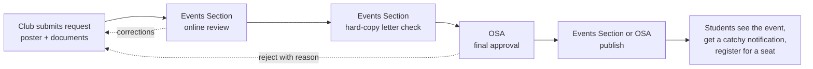
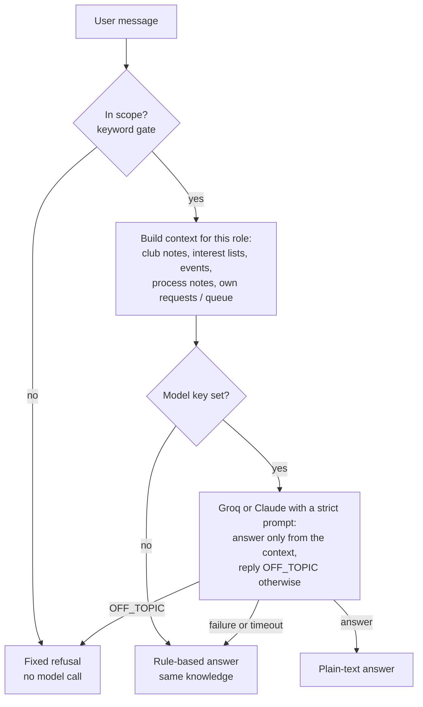
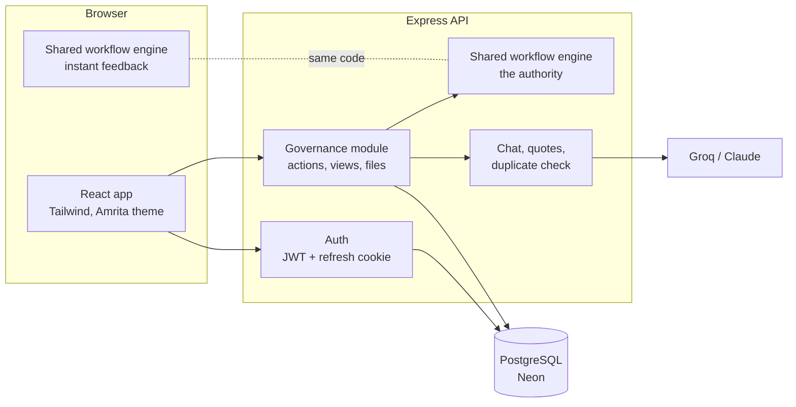

# GENESIS Campus Connect

### Unified Campus E-Governance & Service Request Portal

**Team STORMBREAKER** · GENESIS Hackathon 2026

> One campus. One place for every request. Clubs submit event requests, the Events Section and the Office of Student Affairs (OSA) review and approve them in a tracked, role-enforced workflow, and students discover, register for and get notified about approved events, with an AI assistant that knows every club.

[Problem](#1-the-problem) · [Solution](#2-our-solution) · [Demo for the jury](#3-five-minute-demo-for-the-jury) · [Features](#4-what-we-built) · [AI](#5-ai-in-the-product) · [Architecture](#6-architecture) · [Security](#7-security-and-trust) · [Tech stack](#8-tech-stack) · [Quality](#9-quality-and-testing) · [Run it](#10-run-it-locally) · [Deploy](#11-deployment) · [Team](#13-team)

---

## 1. The problem

University life runs on informal channels, and that costs everyone time:

- **Students** do not know which clubs exist, what each one actually does, or when events happen. Announcements are scattered across WhatsApp groups and posters, so good events are missed and seats go unfilled.
- **Clubs** send event requests on paper and in chat messages. They cannot see where a request is stuck, and corrections come back late and unclear.
- **Administrators** (Events Section and OSA) review requests with no shared tracker, so documents, hard-copy letters, venue clashes and final approval are chased by hand. Nothing guarantees an event is approved _before_ it is advertised.
- **Nobody** has one trustworthy record of what was requested, who approved it and when.

## 2. Our solution

GENESIS Campus Connect is one web portal with three entry points (**Student**, **Club Authority**, **Administrator**) and one visible approval path:



What changes for each person:

| Who                | Before                             | With GENESIS Campus Connect                                                                                                        |
| ------------------ | ---------------------------------- | ---------------------------------------------------------------------------------------------------------------------------------- |
| **Student**        | Hunts through chats and posters    | One dashboard of approved events, a club directory of 26 Amrita clubs, one-click seat registration, notifications, an AI assistant |
| **Club Authority** | Paper letters, no visibility       | A guided request form, a five-step tracker, written feedback, resubmission with versioning                                         |
| **Events Section** | Chases documents and letters       | A review queue, a separate hard-copy verification step, venue-clash flags, publish and notify                                      |
| **OSA**            | Approves without a clear checklist | Final approval unlocked only when review and hard-copy check are done; decides new-club applications                               |

Design principles: **the server is the authority** (the browser only hides buttons), **nothing reaches students until it is approved**, and **every step leaves a visible, timestamped record**.

## 3. Five-minute demo for the jury

Run it (see [section 10](#10-run-it-locally)) and open http://localhost:5173. The sign-in screen has a **Fill** button for each demo account.

| Role           | Choose on first screen | User ID      | Password     |
| -------------- | ---------------------- | ------------ | ------------ |
| Student        | Student                | `STU2026001` | `student123` |
| Club Authority | Club Authority         | `CLUB001`    | `club123`    |
| Events Section | Administrator, Events  | `EVT001`     | `events123`  |
| OSA            | Administrator, OSA     | `OSA001`     | `osa123`     |

1. **Club Authority** → _Event Requests → New request_. Fill the form, attach a poster and the three required documents, press **Submit for review**. Watch the five-step tracker.
2. **Events Section** → open the request → **Clear online review**, then **Record hard-copy check** (reference number). Note that **Grant final approval is locked** with an explanation; the server refuses it too.
3. **OSA** → open the same request → **Grant final approval**. (Try _Request corrections_ or _Reject_ first on another request to see the feedback loop.)
4. **Events Section** → **Publish & notify students**. Only now does the event exist for students.
5. **Student** → the event is on the dashboard with a notification such as _"Midnight Maker Sprint just dropped"_ carrying an event-specific hook line. Register for it; the seat count updates for everyone.
6. **Student → Campus AI Assistant**: ask _"I like music, which clubs suit me?"_, _"What is GDSC for?"_, _"What are the current events?"_, then try _"solve 12\*13+7"_ and see that it politely refuses.
7. **Administrator** → _Club Applications_ → run the **AI duplicate-club check** and approve a new club; it appears for students at once.
8. **Sign out** from the sidebar (every role has it). Sessions expire after two hours.

## 4. What we built

### Student portal

Dashboard with countdowns · explore and search events with live seat counts · event details · **one-click registration checked by the server** (a full or closed event cannot be booked; two students racing for the last seat cannot both get it) · calendar · registrations and history · clubs directory with favourites · notifications · **Campus AI Assistant** · profile and settings.

### Club Authority portal

Overview · club profile (own club only) · members · event requests with poster and documents, 2-day notice rule, 9 PM timing warning, venue-clash and capacity warnings · five-step tracker, feedback and **version history on resubmission** · promotion requests (dashboard, poster boards, signage, newsletter) · our events.

### Events Section

Review queue with filters · online review (clear, request corrections, reject with a mandatory reason) · **separate hard-copy letter verification** with date and reference number · publish and notify students · promotion review · club applications (view and AI check) · club directory · reports and audit trail.

### OSA

Everything the Events Section does, plus **final approval** (the only role that can) and **approve / reject / ask corrections on club applications**, which needs the three documents, at least 10 founding members, the duplicate check and a confirmation when a very similar club exists.

### Club directory

The portal ships with the team's **26 Amrita clubs in four groups**: Technical & Engineering (11), Cultural & Fine Arts (6), Business & Entrepreneurship (4), Media, Lit & Social Responsibility (5).

### Theme

The interface follows the **Amrita brand identity** (amrita.edu/branding): AM Maroon `#A4123F`, black as the secondary colour, Open Sans. Success states stay green so they never read as the brand red.

## 5. AI in the product

Three AI-assisted features, all **advisory**: AI never approves or rejects anything.

### 5.1 Chat assistant for every role

A strictly scoped assistant for **clubs, events and the portal only**.

- **Knows the clubs.** It explains what each club is for and **recommends clubs by interest**: "I like music" → Raagasudha; "AI and machine learning" → Tensor AI, Intel IoT Club; "debate" → ASDS; "startups" → ACE, ELITE.
- **Knows the events.** Current and upcoming events, deadlines and live seat counts.
- **Knows the portal.** How to register, how approval works, which documents a request needs, who can approve what, answered for the person's role (a club also sees the status of its own requests; an administrator sees the review queue).
- **Refuses everything else.** Maths, code, homework, jokes, general knowledge and "ignore your rules" messages are refused with a fixed sentence.

How it works (a light retrieval-augmented design, with no vector database because the data is small):



Student answers are built only from what students may see. The API key stays on the server and never reaches the browser.

### 5.2 Notifications designed to be opened

When an event is published, students get a notification written to be tapped, in the spirit of a food-delivery app: an emoji, the event name, an **event-specific hook line written by the language model** (Groq) from the event's own title and description, the facts, the deadline and a nudge.

> **⚙️ Robotics Arena Showdown just dropped**
> "Watch bots battle line-followers and sumo in real time, who will dominate the arena?" Hut Labs opens registration for 06 Nov 2026, 10:00 AM at West Sports Hall. Only 110 seats, so grab yours before they're gone. Registration closes 03 Nov 2026. Tap to claim your spot →

The model line is cleaned (no links, emojis or markdown, one sentence), rejected if it is a refusal, and replaced by a static category quote if the model is slow or down, so a notification always goes out. Registration confirmations ("You're in! 🎉") use fixed copy.

### 5.3 Duplicate-club check

When a new club applies, the server compares it with existing clubs (name, objectives, category) and gives OSA a similarity score and reasons, so overlapping clubs are caught before approval.

## 6. Architecture



**The key idea: the same rules run twice.** The approval engine in `shared/src/gov` is plain JavaScript used by both sides. The browser runs it for an instant answer, then the backend runs it again on the stored state with the person's real role, inside one database transaction, and its result replaces the browser's. A change the server refuses is dropped and reported. So the interface feels instant but cannot be used to bypass a rule.

**What each portal receives is decided by the server.** Students get published events only. A club gets its own requests in full and other clubs' pending requests only as a time slot (so venue clashes still show). Administrators get everything.

```
frontend/   React 18 + Vite + Tailwind. A static site (Vercel, Netlify...).
backend/    Node 20 + Express + Knex on PostgreSQL (Neon). Auth, governance module, AI services.
shared/     Workflow engine, permissions, club knowledge, notification copy, per-portal views, sample data.
e2e/        Playwright journeys that drive a real browser against the real backend.
docs/       Architecture, deployment and the original project specification.
```

Details: [`docs/ARCHITECTURE.md`](docs/ARCHITECTURE.md). Data lives in a handful of tables (`users`, auth tokens, `gov_docs` for requests, promotions, applications and clubs, `gov_registrations` for seats, `gov_user_state`, `gov_files` for posters). Posters are stored in the database, so the backend needs no persistent disk.

## 7. Security and trust

- **One door per account.** `POST /auth/login` takes the chosen portal. A student cannot enter the Administrator screen; a wrong password and a wrong door give the same message and count as the same failed attempt (brute-force lockout).
- **Role checks on the server for every action**, tested by calling the API directly and bypassing the screens. The Events Section cannot give final approval; a club cannot touch another club's request.
- **Passwords** are hashed with bcrypt. Access tokens last two hours; a rotating refresh token in an httpOnly cookie detects reuse and revokes the session family.
- **Least data per portal** (see section 6) and an assistant that only sees what the asking role may see.
- **Uploads are validated by file signature**, not by name or declared type; unknown document fields are dropped; every action argument is bounded in size and depth.
- **Seats are race-safe**: the seat check and the booking run in one transaction under a lock.
- **Prompt-injection defences**: retrieved text and event descriptions are delimited and treated as data, the model is told to refuse off-topic requests, and its output is cleaned.
- Standard hardening: `helmet`, strict CORS, rate limits, no secrets in the repository, demo accounts disabled in production.

## 8. Tech stack

| Layer    | Technology                                                                                                       |
| -------- | ---------------------------------------------------------------------------------------------------------------- |
| Frontend | React 18, Vite 5, React Router 6, Tailwind CSS 3, lucide-react, Open Sans                                        |
| Backend  | Node.js 20, Express 4, Knex, own authentication (bcryptjs, jsonwebtoken), helmet, cors, express-rate-limit, pino |
| Database | PostgreSQL on Neon (SQLite only inside automated tests and the browser-test stack)                               |
| Shared   | Plain JavaScript (ES modules), Zod                                                                               |
| AI       | Groq (default `openai/gpt-oss-120b`) or Claude via the official SDK, called only from the backend                |
| Testing  | Vitest, Supertest, React Testing Library, Playwright (Chrome)                                                    |
| Tooling  | ESLint, Prettier, GitHub Actions CI, npm workspaces                                                              |

## 9. Quality and testing

| Suite                                                                                                        | Tests | Status |
| ------------------------------------------------------------------------------------------------------------ | ----- | ------ |
| Shared: workflow engine, notification copy, permissions                                                      | 19    | pass   |
| Backend: auth, governance rules, per-portal views, seats and races, uploads, chat scope, quotes, Groq client | 65    | pass   |
| Frontend screens against an in-memory API running the real engine                                            | 14    | pass   |
| **End-to-end journeys in real Chrome** against the real backend (every role, every main flow)                | 19    | pass   |

Highlights: the full approval path through four roles, the Events Section being refused final approval **even when the screen is bypassed**, a **race test where two students take the last seat** (exactly one succeeds), off-topic chat refusals, and 36 screens opened with no console errors. Lint is clean. The browser tests run on a throwaway database, never on the real one.

## 10. Run it locally

You need Node 20+ and a PostgreSQL database; a free [Neon](https://neon.tech) project works.

```bash
npm install
cp backend/.env.example backend/.env      # fill in DATABASE_URL and a long random JWT_SECRET
npm run db:migrate                        # create the tables
npm run db:seed                           # sample clubs, events, requests and demo accounts
npm run dev                               # backend :4000 and frontend :5173
```

Optional AI: set `GROQ_API_KEY` (or `ANTHROPIC_API_KEY`) in `backend/.env`. Without a key the chat and notifications still work with built-in rules and static quotes. **Do not put `#` in a value** (it starts a comment) and **never commit `backend/.env`**.

| Command                          | What it does                                       |
| -------------------------------- | -------------------------------------------------- |
| `npm run dev`                    | Backend and frontend together                      |
| `npm test`                       | Shared, backend and frontend tests                 |
| `npm run test:e2e`               | Browser journeys against a throwaway database      |
| `npm run build`                  | Production build of the frontend                   |
| `npm run db:migrate` / `db:seed` | Create or update the tables / load the sample data |
| `npm run lint`                   | ESLint and Prettier check                          |

## 11. Deployment

Designed as two independent deployables plus a managed database: **frontend** on Vercel or Netlify (`frontend/vercel.json` is included and forwards `/api` to the backend), **backend** on Render, Railway or Fly (`npm start -w backend`), **database** on Neon. Environment variables, the cross-domain cookie setup and a checklist are in [`docs/DEPLOYMENT.md`](docs/DEPLOYMENT.md).


## 12. Team

**Team STORMBREAKER**

Repository contributors (GitHub): [@shreesanth-78](https://github.com/shreesanth-78) · [@hemanthf224](https://github.com/hemanthf224) · [@kirupashankarchockkanathan](https://github.com/kirupashankarchockkanathan) . [@Adi-0202](https://github.com/Adi-0202)

Built for the **GENESIS Hackathon 2026**. The original specification is kept in [`docs/PROJECT_SPEC.md`](docs/PROJECT_SPEC.md).
